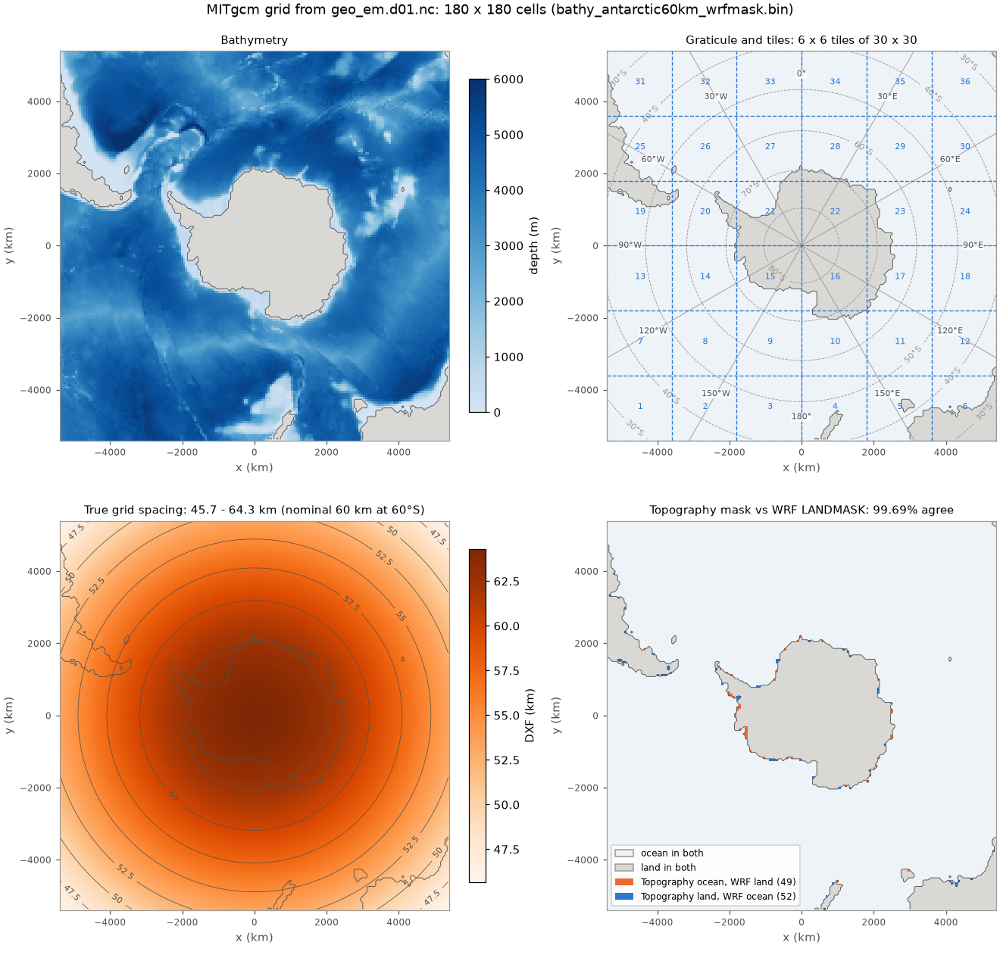

# gen_mitgcm_polar

Build a regional **MITgcm** setup on the same grid as a **WRF polar-stereographic domain**
(WPS `geo_em` file, `MAP_PROJ=2`):

* a curvilinear MITgcm grid **co-located with WRF** (same tracer, u, v and corner points)
* **bathymetry** from ETOPO 2022, with a land/sea mask identical to WRF `LANDMASK`
* **initial conditions** (T, S, U, V, η) from a GLORYS12 snapshot
* **open-boundary conditions** (pkg/obcs) from GLORYS12 7-day snapshots, downloaded only
  along the boundaries

The scripts need only numpy and scipy (plus matplotlib for figures). The projection code
works for either pole.

## Example domain

| | |
|---|---|
| Projection | WRF polar stereographic (MAP_PROJ=2), true latitude 60°S, STAND_LON 0°, centred on the South Pole |
| Size | 180 × 180 tracer cells × 52 levels (6000 m) |
| Nominal spacing | 60 km at 60°S; true spacing 45.7 km (corners, ~25°S) to 64.3 km (pole) |
| Earth model | sphere, R = 6370 km (same as WRF) |
| Domain edge | ~41°S at edge midpoints, ~25°S at the corners |

---

## Requirements and inputs

```bash
pip install numpy scipy matplotlib netCDF4 copernicusmarine
copernicusmarine login            # free Copernicus Marine account, needed for GLORYS
```

Put these files in the repository folder (they are git-ignored):

| File | Where to get it |
|---|---|
| `geo_em.d01.nc` | your WPS output (`geogrid.exe`) |
| `ETOPO_2022_v1_60s_N90W180_surface.nc` | [NOAA ETOPO 2022](https://www.ncei.noaa.gov/products/etopo-global-relief-model), 60 arc-second, *surface* version |
| `data` | MITgcm `data` file. Only `delZ` is read (already in the repo for the example) |

---

## Workflow

Run everything from the repository folder:

```bash
bash run.sh
```

`run.sh` has three parts:

| Part | Command | Output |
|---|---|---|
| **1. Grid** | `make_bathy.py` | `grid/bathy_antarctic60km.bin`, `grid/bathy_antarctic60km_wrfmask.bin`, `grid/bathy_report.txt`, `grid/grid_check.png` |
| | `make_old_grid_io.py` | `grid/prec32/*.bin`: 16 grid files for `OLD_GRID_IO`, plus a copy of the bathymetry |
| **2. Initial conditions** | `save_glorys/download.py`, then `mv` into `save_glorys/` | `save_glorys/CMEMS_SO_2016-01-01.nc` (one GLORYS day, all longitudes, 80°S–23°S) |
| | `make_mitgcm_ic_ps.py` | `ic_obcs/{T,S,U,V,Eta}_init.bin`, `data_snippet.txt`, `ic_report.txt`, `ic_check.png` |
| **3. Boundary conditions** | `download_glorys_obc_ps.py --start 2016-01-01 --end 2019-01-07` | `save_glorys/obc_<side>_<seg>.nc`, `segments.csv`, `segments_map.png` |
| | `make_mitgcm_obc_ps.py` | `ic_obcs/OB{W,E,S,N}_{T,S,U,V,Eta}.bin`, `obcs_snippet.txt`, `obc_report.txt`, `obc_check.png` |

To change the period or domain, edit the dates and latitude range in
`save_glorys/download.py` (initial condition) and `--start/--end` in `run.sh` (boundary
conditions). Use the same start date in both. Every script prints its options with `-h`.

All binary files are big-endian. Model fields are float32 (`readBinaryPrec=32`) with shape
(Nr, Ny, Nx) in C order, which is Fortran (Nx, Ny, Nr).

### Repository layout

```
run.sh            the workflow above
data              MITgcm 'data' (delZ is read from here)
scripts/          make_mitgcm_grid.py   grid co-located with WRF; plot_grid_check() figure
                  make_bathy.py         cell-averaged bathymetry, WRF-mask variant, grid_check.png
                  make_old_grid_io.py   grid as 16 global files for OLD_GRID_IO
                  make_mitgcm_ic_ps.py  initial conditions
                  download_glorys_obc_ps.py   GLORYS along the open boundaries, in segments
                  make_mitgcm_obc_ps.py open-boundary files
grid/             grid and bathymetry outputs
ic_obcs/          initial- and boundary-condition outputs
save_glorys/      GLORYS downloads (download.py for the IC snapshot)
check_glorys/     optional check of the boundary files against a full-domain GLORYS snapshot
```

---

## Grid

`make_mitgcm_grid.py` computes the grid directly from the WRF projection parameters in
`geo_em`, in double precision. The other scripts import its `build()` function.

### Co-location
Both models use an Arakawa C-grid, so every staggered point is the same point:

| MITgcm | WRF | max offset |
|---|---|---|
| tracer `XC, YC` (i, j) | mass point `XLAT_M, XLONG_M` (i, j) | 3 m |
| u point (west face of cell i) | `XLAT_U, XLONG_U` (i) | float32 noise |
| v point (south face of cell j) | `XLAT_V, XLONG_V` (j) | float32 noise |
| corner `XG, YG` (SW corner) | `XLAT_C, XLONG_C` (i, j) | 3 m |

Index (i, j) in MITgcm = (west_east, south_north) in WRF, with no flips and no offset. The
~3 m offsets come from WRF storing lat/lon as float32.

### Metrics
All 16 metrics are **exact integrals over the projection plane**: lengths are ∫ ds/m and
areas ∫∫ dA/m², with m the polar-stereographic map factor, computed by 8-point
Gauss–Legendre quadrature. They agree with WRF `DX/MAPFAC_M` to 2e-6 and
`DX·DY/MAPFAC_M²` to 9e-6. Those residuals are the variation of m within a cell, which a
single-point map factor can't represent.

### Rotation angles (important for wind/stress forcing)
`AngleCS, AngleSN` follow the MITgcm convention:

    u_east  = AngleCS*u_grid - AngleSN*v_grid
    v_north = AngleSN*u_grid + AngleCS*v_grid

`AngleCS` equals WRF `COSALPHA`, but **`AngleSN` = −`SINALPHA`**, because WRF stores
`SINALPHA` with the opposite sign. WRF grid-relative winds can be passed to MITgcm
unrotated, because the grids share axes. Rotate only earth-relative (east/north) winds,
and then use these angles, not WRF's `SINALPHA`.

### Grid file formats
* **`make_old_grid_io.py`** (used by `run.sh`): 16 global files
  `LONC LATC DXF DYF RA LONG LATG DXV DYU RAZ DXC DYC RAW RAS DXG DYG .bin` (Nx × Ny,
  precision `--prec 32|64`), read with `#define OLD_GRID_IO` in `CPP_OPTIONS.h`. Any
  `SIZE.h` tiling works. MITgcm computes the grid angles itself in this format.
* **`make_mitgcm_grid.py geo_em.d01.nc OUTDIR --name NAME --snx 30 --sny 30`**: big-endian
  real*8 files with 18 records of (sNx+1) × (sNy+1), in the order XC YC DXF DYF RA XG YG
  DXV DYU RAZ DXC DYC RAW RAS DXG DYG AngleCS AngleSN, read with `horizGridFile`. It writes
  one file per tile (`tiles/NAME.faceNNN.bin`, for builds without exch2) and one facet
  (`NAME.face001.bin`, for exch2), plus `XC/YC/AngleCS/AngleSN.bin` and
  `grid_verification.txt`. sNx and sNy must divide 180.

---

## Bathymetry

`make_bathy.py` projects every ETOPO node into the WRF plane and bins it into the 60 km cell
that contains it, giving an exact cell mean with no interpolation. Per cell, depth is the
mean of min(z, 0), and the cell is ocean if at least 50% of its nodes are below sea level.
Depths are clipped at `--maxdepth` (the bottom of `delZ`, 6000 m). One-cell dead-end
inlets, and basins not connected to an open boundary, are removed.

Two files are written:
* `bathy_antarctic60km.bin`: mask from the topography
* `bathy_antarctic60km_wrfmask.bin`: mask forced to **WRF `LANDMASK`** (recommended for
  coupling, and used by `run.sh`). Cells made ocean get at least 9.2 m depth (the top two
  levels).

Result for the example (ETOPO 2022, 60″; `grid/bathy_report.txt`):
* 668–210,430 ETOPO nodes per cell; 27,649 wet cells of 32,400; depths 2.3–6000 m
* 4 cells removed as lakes or isolated basins
* the topography mask agrees with WRF in 99.69% of cells (49 cells wet only in MITgcm,
  52 wet only in WRF); the `_wrfmask` file has 27,652 wet cells
* all four sides are open ocean (W 128, E 143, S 135, N 178 wet cells), so pkg/obcs is
  required

`make_bathy.py` also draws **`grid/grid_check.png`**. Its four panels show the bathymetry
of the `_wrfmask` file, the lat/lon graticule with the tiles (`--snx/--sny`), the true grid
spacing, and the topography mask compared with WRF `LANDMASK`. Use `--no-plot` to skip it.



**Caveats**
* The *surface* ETOPO gives the **ice-surface** elevation over Antarctica, so the Ross,
  Ronne–Filchner, Amery and other ice shelves are land and there are no sub-shelf cavities.
  WRF's LANDMASK treats them the same way. For cavities (pkg/shelfice), use RTopo-2 or
  BedMachine Antarctica and regenerate.
* Without exch2, MITgcm is periodic by default, which is wrong for this domain. Use
  pkg/obcs (or a sponge/relaxation zone).

---

## Initial conditions

`make_mitgcm_ic_ps.py` reads a GLORYS snapshot covering the whole domain
(`save_glorys/CMEMS_SO_2016-01-01.nc`, all longitudes, 80°S–23°S), one depth level at a
time, in NetCDF-3 or NetCDF-4.
1. It fills GLORYS land and sea floor from the nearest ocean point, per level.
2. It interpolates bilinearly to the C-grid points: T, S and η at cell centres, U on west
   faces, V on south faces. Longitude wraps around 180°.
3. It interpolates vertically to the model cell centres (from `delZ`).
4. It **rotates** GLORYS east/north velocities to the grid directions at each U/V point.
5. It sets U and V to 0 where the face is land in the bathymetry. T and S keep the filled
   values on land, which MITgcm ignores.

Namelist lines are in `ic_obcs/data_snippet.txt`:
```
 &PARM05
 hydrogThetaFile='T_init.bin', hydrogSaltFile='S_init.bin',
 uVelInitFile='U_init.bin', vVelInitFile='V_init.bin', pSurfInitFile='Eta_init.bin',
 &
```

**Fresh water in the Río de la Plata.** GLORYS includes the river plume, with salinity close
to 0 in a few shallow cells (i = 2–8, j = 145–147). MITgcm then stops with
`INI_SALT: found 1 wet grid-pts with salt=0`. This is real fresh water, so set
`checkIniSalt=.false.` in `PARM05`. With a nonlinear equation of state, check the first
outputs there for negative or NaN salinity.

GLORYS gives potential temperature and practical salinity, which is right for MITgcm's
default equations of state. Convert them if you use `eosType='TEOS10'`.

---

## Open-boundary conditions

### Downloading only the boundaries
Each straight model boundary curves through about 90° of longitude in lat/lon space, so one
box per side would download most of the latitude band. `download_glorys_obc_ps.py` splits
every side into **segments of 10 cells** and downloads a small box around each, covering
the boundary cells and the first interior cells with 0.25° padding. 11 of the 72 segments
are all land and are skipped. A segment crossing 180° is downloaded in two parts and
joined. `--dry` prints the plan and estimated size and draws `segments_map.png` without
downloading.

### Snapshot dates
Give the downloader the **model start and end dates**. It downloads a snapshot on
`--start`, then every 7 days (`--period`), up to and including one extra snapshot at or
after `--end`. The first record is then the model start, and the last one covers the
model end. MITgcm/EXF only needs the date of the first record and a fixed period, so leap
years never matter.

* `run.sh` downloads `--start 2016-01-01 --end 2019-01-07`: 159 snapshots,
  2016-01-01, 01-08, … 2019-01-04, 2019-01-11.
* EXF reads `obcs*startdate1/2` as the date of the **first record** and interpolates in
  time between records. It stops (`ABNORMAL END: S/R EXF_GetFFieldRec`) if the model starts
  before the first record, and it must not run past the last record.
* A snapshot is the GLORYS **daily mean** of that day.
* The segment files are named by segment, not by date, and existing files are skipped. If
  you change `--start`, `--end` or `--period`, download into an empty folder.
* `download_glorys_obc_ps.py ... --check --outdir save_glorys` lists the dates and value
  ranges of the downloaded files. `ncdump -t -v time file.nc` shows dates readably.

### Building the boundary files
`make_mitgcm_obc_ps.py` reads the segment files and writes one file per side and variable,
with all snapshots in time order. GLORYS is interpolated bilinearly to each boundary point,
then vertically to the model levels, and velocities are rotated to the grid directions:

| side | tracers / η | normal velocity | tangential velocity |
|---|---|---|---|
| W | cells i=1 | U at i=2 (`OB_Iw+1`) | V on column i=1 |
| E | cells i=Nx | U at i=Nx (`OB_Ie`) | V on column i=Nx |
| S | cells j=1 | V at j=2 (`OB_Js+1`) | U on row j=1 |
| N | cells j=Ny | V at j=Ny (`OB_Jn`) | U on row j=Ny |

### MITgcm settings
`ic_obcs/obcs_snippet.txt` has the exact lines:
```
# data.obcs
 &OBCS_PARM01
 OB_Iwest = 180*1, OB_Ieast = 180*180, OB_Jsouth = 180*1, OB_Jnorth = 180*180,
 useOBCSprescribe = .TRUE.,
 useOBCSbalance   = .TRUE.,
 OBWtFile='OBW_T.bin', OBWsFile='OBW_S.bin', OBWuFile='OBW_U.bin', OBWvFile='OBW_V.bin',
 ... (same for E, S, N)
 &
# data.exf
 &EXF_NML_OBCS
 obcsWstartdate1 = 20160101, obcsWstartdate2 = 000000, obcsWperiod = 604800.0,
 ... (same for E, S, N)
 &
```
plus `useOBCS`, `useEXF` and `useCAL` in `data.pkg`, and `#define ALLOW_OBCS_PRESCRIBE` and
`#define ALLOW_OBCS_BALANCE` in `OBCS_OPTIONS.h`. U and V in the files are grid-relative.
The `OB*_Eta.bin` files are only used with a non-linear free surface.

**Keep `useOBCSbalance=.TRUE.`** Any net inflow goes straight into sea level: in this domain
0.1 Sv is about 3.6 cm per year, and 1 Sv about 36 cm per year. `obc_report.txt` lists the
net inflow of each record before balancing.

---

## Checks

| Output | What it shows |
|---|---|
| `grid/grid_check.png`, `grid/bathy_report.txt` | bathymetry, tiles, grid spacing, mask vs WRF |
| `ic_obcs/ic_check.png`, `ic_report.txt` | surface T and velocity, S, η, T at 500 m; value ranges |
| `ic_obcs/obc_check.png`, `obc_report.txt` | boundary sections and net inflow per side over time |
| `save_glorys/segments_map.png` | the download boxes over the model boundary |
| `check_glorys/` | GLORYS along the boundaries from a full-domain snapshot (`plot_glorys_boundary_full.py`), with inflow, outflow and net transport per side, compared with the OB files |
